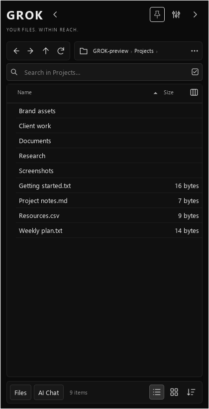

# GROK

**Graphical Resource Organization Kit**  
**Your files. Your AI. All in one sidebar.**  
Made by **akasumitlamba** · Version **1.0.0**

GROK is an independent Windows desktop file utility. Its 42-pixel right-edge dock expands inward into a compact black file panel. AI Chat is always discoverable from the dock and bottom navigation; external requests remain disabled until configured. No GROK backend or account is required.



## Download and project handoff

Get the Windows x64 MSIX from [GitHub Releases](https://github.com/akasumitlamba/grok-files/releases). This private repository and its downloads require repository access. Version 1.0.0 is a development prerelease: its local signing certificate must be trusted before installation. See [installation instructions](docs/INSTALL.md). Installed-MSIX behavior remains unverified.

Human contributors and AI assistants should start with [PROJECT_CONTEXT.md](PROJECT_CONTEXT.md). [AGENTS.md](AGENTS.md) points coding agents to the same source of project context.

## Features

- Click or Ctrl+Alt+G to expand/collapse; Escape to collapse. Configurable shortcut, work-area placement, monitor selection/fallback, narrow/medium/wide widths, pin and optional auto-hide.
- Real filesystem navigation, editable paths, breadcrumbs, back/forward/up, drives, Windows known folders, favorites, local filename filtering and sorting.
- Explicit selection mode with no hidden-checkbox gutter, expandable non-empty folders, multiselect, copy/cut/paste, explicit move destination, rename, new folder, recycle, Windows properties, open with and default applications.
- Native file URLs/Windows clipboard drag/drop. Ctrl requests copy; Shift requests move; incoming same-volume drops default to move. Collision protection refuses replacement. Progress and cooperative cancellation.
- List/grid modes, ascending/descending sorting by name, size, type or modified date, and a column picker. Narrow panels allow Name plus one detail; wider panels allow more. A side arrow opens a full-work-area layout with files and chat side by side.
- Neutral black surfaces and original compact line icons, tooltips, keyboard access and accessible names. Secondary columns appear at wider sizes.
- Independent OpenAI, Gemini, xAI, Claude, DeepSeek, Groq, Mistral, OpenRouter and Together AI HTTPS adapters, user-specified models, Credential Manager keys, connection tests and locally saved chat. Text-file/folder-listing attachments require a preview.
- Separate static website, privacy policy, terms, original Windows icon sizes, executable and MSIX build scripts.

## Status

Read [QA report](docs/QA.md) for the exact verified scope and release blockers. The source and built artifacts are not a claim that every physical monitor, network drive or third-party API configuration has been certified. This is not an official xAI Grok product.

## Requirements and setup

Windows 10 build 19041+ or Windows 11, x64. Python 3.11+ for development (built with Python 3.13.5). Windows SDK MakeAppx/SignTool for packaging. No Python installation is needed for the built distribution.

```powershell
python -m venv .venv
.\.venv\Scripts\Activate.ps1
python -m pip install -e ".[dev]"
python src/main.py
```

## Build, tests and packaging

```powershell
python -m pytest -q
python tools/make_assets.py
python tools/site.py
python tools/capture_preview.py
.\tools\build.ps1
.\tools\package.ps1
```

`build.ps1` runs tests and creates `dist/GROK/GROK.exe` plus `_internal`. Keep the folder intact. `package.ps1` validates and creates `release/GROK.msix`. Without a signing thumbprint that package is unsigned. See [installation and signing](docs/INSTALL.md) for development signing, installation and Store identity replacement.

```powershell
.\tools\development-certificate.ps1
.\tools\package.ps1 -CertificateThumbprint '<thumbprint printed by the certificate script>'
```

The default publisher `CN=akasumitlamba` is a local development identity, not a Microsoft Store identity. Never distribute the private certificate key. The script creates it as non-exportable in your current-user certificate store.

## Architecture

| Module | Responsibility |
|---|---|
| `src/main.py` | Qt startup, per-session instance lock |
| `src/grok/ui.py` | Dock/panel composition, settings and user workflows |
| `src/grok/browser.py` | Async Qt filesystem model, local filtering, sorting, clipboard MIME and drag/drop |
| `src/grok/files.py` | Validated filesystem operations; no replacement or junction traversal |
| `src/grok/dock.py` | Work-area geometry, including negative monitor coordinates |
| `src/grok/windows.py` | Credential Manager, global shortcut, known folders, startup and shell dialogs |
| `src/grok/ai.py` | Isolated direct HTTPS provider adapters; no automatic file context or tools |
| `src/grok/storage.py` | Local settings and navigation history |
| `src/grok/workers.py` | Background tasks, completion and failure delivery |
| `src/grok/icons.py` | Original consistent line icons |
| `website/` | Static pages with no JavaScript, cookies, analytics or external assets |

The browser does not need credentials, AI activation or a network connection. Qt enumerates directories asynchronously. Mutations and path validation use background workers. No full-disk index or polling scan runs in the background.

## Privacy and AI

Preferences and favorites are local JSON; they may include private paths and are not encrypted. Keys use Windows Credential Manager. GROK saves conversations locally as unencrypted JSON, separately per provider and creates no request logs or telemetry. The current chat is resent to the selected provider when you press Send. Tests can incur provider charges. Review the [privacy policy](website/privacy/index.html).

Enter a model ID your API account supports; consumer chat subscriptions do not necessarily include API access. GROK implements the documented [OpenAI Chat Completions](https://platform.openai.com/docs/api-reference/chat/create), [Gemini generateContent](https://ai.google.dev/api/generate-content) and [xAI Chat Completions](https://docs.x.ai/developers/rest-api-reference/inference/chat-completions) request formats. Live account/model compatibility must be checked with your credentials. No developer keys are shipped.

Only UTF-8 text files up to 100 KB and up to 500 folder names are supported as attachments. PDF/Office extraction, streaming and AI-driven file mutations are not implemented. AI output is displayed as escaped text and cannot execute commands.

## Website

Open `website/index.html`, or serve that folder with `python -m http.server 8787 --directory website`. Publish the **website folder only** to GitHub Pages or equivalent hosting. Relative links support repository subpaths. Copy the signed `release/GROK.msix` and public `.cer` into `website/download/` if distributing a development build. Do not publish the private key or development state. No website has been publicly deployed by the build scripts.

## Troubleshooting

- **Only a tiny dock is visible:** click the folder icon or press Ctrl+Alt+G. Right-click the dock for Settings/Quit; the tray also has a Quit command.
- **Shortcut unavailable:** another program registered it. Choose a different Ctrl/Alt/Shift plus letter in Settings.
- **Missing folder/drive:** navigate elsewhere or reconnect the drive; check Windows permissions.
- **Transfer refused:** existing destination names are never replaced or merged. Rename first or choose another destination. Junctions, symlinks and reparse points are deliberately rejected; use Explorer for them.
- **Transfer canceled/failed:** completed items remain. A partially copied directory can remain too. The source is retained until its copy succeeds. Inspect both destinations before retrying. There is no application-level undo.
- **Delete behavior:** Windows controls Recycle Bin support and can ask for confirmation. Network/removable drives may require permanent deletion; cancel if undesired.
- **Provider error:** verify key, model ID, API account billing, quota and internet access. ChatGPT web login is not API authentication.
- **MSIX trust error:** read the signing guide; unsigned or untrusted development packages cannot install normally.

## Roadmap

Target-machine drag/drop and DPI matrix; shell-native transactional operations/undo; richer transfer progress; recursive search opt-in; PDF/Office extraction with content review; streaming provider responses; Store-assigned identity and signed public release.

See [security review](docs/SECURITY.md), [manual test plan](docs/MANUAL-TESTS.md), and [third-party notices](docs/THIRD-PARTY-NOTICES.md).

Future file-editing, conversion and terminal tools are specified in [AI tools roadmap](docs/AI-TOOLS-ROADMAP.md), not implemented in this version.

## Minor usability refinements

- The sort menu marks the currently active sort field.
- An empty search result says "No matches"; clearing search restores the item count.
